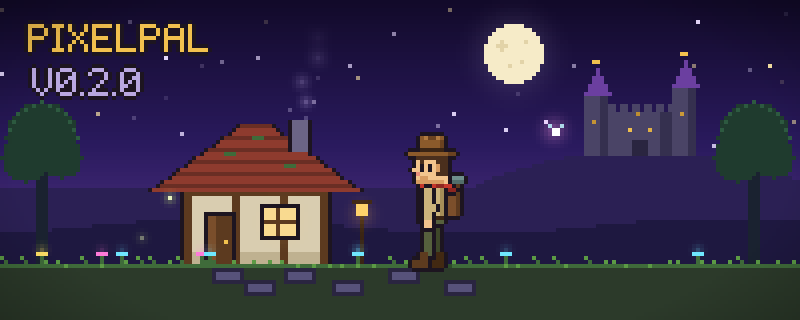
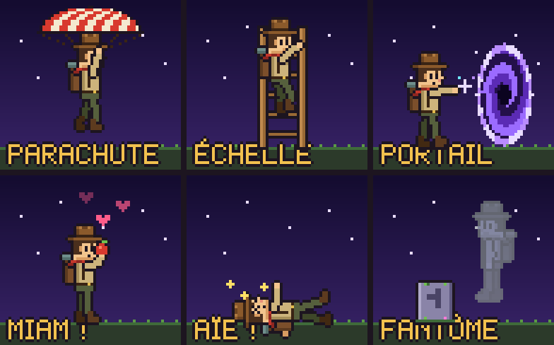
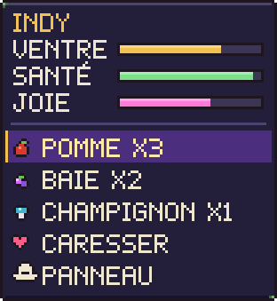
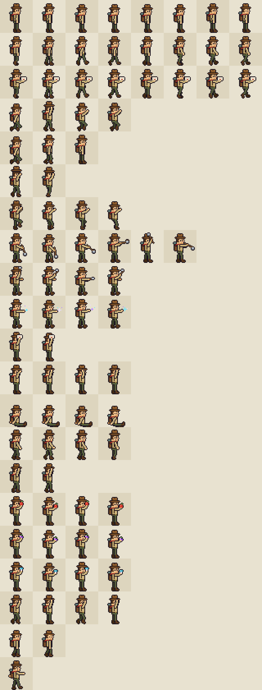

<h1 align="center">PixelPal</h1>

Un petit aventurier en pixel art qui vit sur ton bureau : il passe d'un écran à l'autre, escalade, marche au plafond, a faim comme un Tamagotchi, et livre tes lettres par portail aux collègues, où qu'ils soient.

  
  
  
  
  

Fait par William Loree.

PixelPal lit la disposition de tes écrans dans Windows et y fait vivre un personnage. Il se promène au niveau du bureau, derrière tes fenêtres : une appli au premier plan le cache, et il ne vient jamais s'installer sur celle que tu utilises. Quand un écran est au-dessus, il pose une échelle ; quand il est en dessous, il creuse un trou ; quand rien ne se touche, il ouvre un portail.

On peut l'attraper à la souris, le nourrir, le caresser… et l'oublier : sans manger, il finit en fantôme au-dessus de sa tombe. Et quand tu écris à un collègue, il part livrer la lettre en personne : un visiteur sort d'un portail sur l'écran de chaque destinataire, en même temps, même à l'autre bout d'internet.

## Installer

Télécharger `pixelpal.exe` depuis la [dernière version](https://github.com/williamloree/PixelPal/releases/latest) et le lancer. C'est tout : il se met ensuite à jour tout seul.

Au premier lancement, Windows demande l'accès au réseau : **Autoriser** (il en a besoin pour les lettres).

| Mode | Commande |
| --- | --- |
| Normal | `pixelpal.exe` |
| Développement | `cargo build --release` puis `.\target\release\pixelpal.exe` |
| Deuxième utilisateur sur le même PC (tests) | `pixelpal.exe --profil=2` |

## Ce que tu vois

| Sur l'écran | Ce que ça veut dire |
| --- | --- |
| **L'aventurier** qui se promène, s'assoit, salue | Il va bien. Clic : menu de soins (jauges, nourriture, caresse, panneau). |
| **Une échelle** qu'il cloue puis range une fois monté | Il change d'écran (écran plus haut, ou plus bas). |
| **Un trou** creusé à la pelle | L'écran du dessous ; le trou se rebouche après sa chute. |
| **Lui, tête en bas**, en haut de l'écran | Il a escaladé le bord et se promène au plafond. |
| **Lui, sur le dessus d'une fenêtre** | Il y est monté (saut ou échelle). Il suit la fenêtre si elle bouge, tombe si elle se ferme. |
| **Un parachute** rayé rouge et crème | Lâché de haut, il l'ouvre. Sans parachute : KO, étoiles, −15 santé. |
| **Un portail** violet | Il part livrer une lettre, ou voyage vers un écran qu'aucun chemin ne relie. |
| **Un visiteur** avec une lettre et une bulle | Un collègue t'a écrit. Clic : lu ; il salue et repart, l'expéditeur est prévenu. |
| **Une tombe et un fantôme** | Il est mort de faim. Clic sur le fantôme : « Ressusciter ». |

## Tamagotchi

| | |
| --- | --- |
| **Rythme** | Le temps ne compte que quand l'appli est ouverte (week-ends et vacances en pause). Un repas toutes les 3 h environ. |
| **Faim** | Ventre vide au bout de ~6 h : il s'affaiblit, marche moins vite, s'assoit souvent. Encore ~6 h sans manger : il meurt. |
| **Réserve** | Pomme (+30 ventre), baie féerique (+15 ventre, +20 joie), champignon lumineux (+45 ventre, +10 santé). Le jardin en donne un toutes les 40 min. |
| **Parachutes** | 3 au plus, l'atelier en plie un toutes les 2 h. |
| **Mort** | Tombe et fantôme ; la résurrection remet son âge à zéro, son record est gardé. |

Clic sur le personnage pour le menu, ou panneau > **Soins** pour les détails.

 

## Lettres : pair-à-pair, sans serveur

Chaque PixelPal a un **code d'invitation** fixe (52 caractères, onglet Contacts) : son identifiant public, tiré de sa clé. Ce code marche partout.

| | |
| --- | --- |
| **Connexion** | [iroh](https://www.iroh.computer/) : chiffrée de bout en bout, elle perce les box (NAT) pour aller en direct ; sinon elle passe par un relais public de n0, qui ne peut rien lire. |
| **Réseau local** | Les PixelPal se trouvent tout seuls (annonce UDP + mDNS), sans échanger de code. |
| **Groupes** | On crée un groupe, il est envoyé à tous ses membres. Lettre à « tout le groupe » ou à quelques-uns. |
| **Livraison** | La lettre part chez tous **en même temps** ; chacun voit un visiteur avec la tenue de l'expéditeur. |
| **Identité** | Elle vient de la connexion chiffrée : personne ne peut se faire passer pour un autre. |

## Personnage et tenues

Chaque image est une **pose** (angles des membres, objet tenu, yeux, bouche) dessinée sur 40 × 40 pixels puis détourée calque par calque. Il y a 21 animations : marche, escalade, creuser, poser une échelle, portail, parachute, repas, joie, KO… Le storyboard animé est dans panneau > Perso.

Planche de toutes les animations

## Mises à jour

| | |
| --- | --- |
| **Publication** | À chaque push sur `main`, le workflow `.github/workflows/release.yml` lance les tests, compile et publie `vX.Y.N` avec `pixelpal.exe` (`X.Y` dans `Cargo.toml`, `N` = numéro d'exécution). |
| **Dans l'appli** | Vérification au démarrage, toutes les 6 h, ou panneau > Perso > « Vérifier maintenant ». Il télécharge, remplace son exécutable et redémarre en annonçant la nouvelle version. |
| **Dépôt privé** | Il faut alors un jeton GitHub en lecture (*Contents: Read*) dans `%APPDATA%\PixelPal\github-token.txt`. |

## Raccourcis

| Geste | Action |
| --- | --- |
| Clic sur le personnage | Menu de soins |
| Glisser le personnage | Le tenir par le col ; le lâcher ou le lancer |
| Clic sur un visiteur ou sa bulle | Marquer la lettre comme lue |
| Clic gauche sur l'icône de notification | Panneau |
| Clic droit sur l'icône de notification | « Ouvrir le panneau » / « Quitter PixelPal » |

## Comment ça marche

| Partie | Rôle |
| --- | --- |
| `src/main.rs` | Boucle principale (30 images/s) : prise à la souris, menu, commandes du panneau, envois. |
| `src/monde.rs` | Simulation : écrans et liens, trajets, surfaces (sol, fenêtres, plafond), chutes, visiteurs. |
| `src/soins.rs` | Tamagotchi : faim, santé, joie, réserve, jardin, mort. |
| `src/sprites.rs` | Le personnage par poses ; échelle, trou, portail, parachute, tombe, cœurs. |
| `src/fenetres.rs` | Petites fenêtres Windows transparentes, ordre d'empilement (derrière les applis), fenêtres praticables, écrans, icône. |
| `src/reseau.rs`, `src/pair.rs` | Pair-à-pair iroh, découverte locale, canal local du panneau (127.0.0.1). |
| `src/panneau.rs`, `src/scene.rs`, `src/menu.rs` | Panneau egui, bannière, police pixel maison, menu de soins. |
| `src/maj.rs` | Mise à jour automatique depuis les releases. |
| `src/vitrine.rs` | Les images de ce README : `pixelpal.exe --vitrine assets/images`. |
| `tools/*.ps1` | Outils de test : piloter une instance (`ctl.ps1` avec `PIXELPAL_JETON`), cliquer, lâcher, ouvrir le menu, capturer. |

Tests : `cargo test` (trajets entre écrans, échelles rangées, chutes avec et sans parachute, fenêtres, escalade, repas, mort et résurrection). Données : `%APPDATA%\PixelPal\` (`pixelpal.json`, `cle.bin`).
